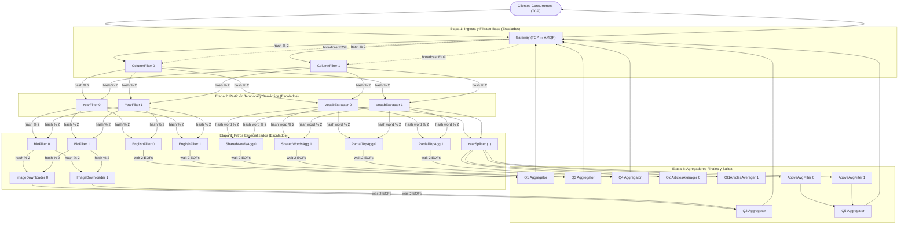

# Informe Técnico: Escalabilidad Horizontal, Sincronización EOF y Concurrencia en el Pipeline Distribuido

## 1. Introducción y Contexto del Problema

El sistema procesa millones de artículos de Wikipedia en formato Parquet a través de un pipeline distribuido de streaming para responder 5 consultas analíticas complejas (Queries 1 a 5).

### El Requisito de la Cátedra
- **Escalabilidad Horizontal Obligatoria ($\ge 60\%$ de los nodos):** Al menos el 60% de los tipos de nodos del sistema deben poder instanciarse en múltiples réplicas concurrentes para balancear carga.
- **Invariante de Orden (Datos vs. EOF):** El stream de datos de un artículo y el paquete de fin de datos (`EOF`) deben llegar en orden estricto. Si un nodo downstream procesa un `EOF` antes de haber consumido todos los artículos previos que le correspondían, el resultado final de la query se corrompe o queda incompleto.
- **Cliente Pasivo y Paquetes Únicos:** El cliente solo recibe un paquete final por query y no participa en la reconciliación o compilación de fragmentos.

### El Problema de la Solución Previa (Managers Monohilo)
La implementación inicial intentó utilizar un nodo intermedio denominado `column_filter_manager` para coordinar el escalado de `column_filter`. 
- **Cuello de Botella 1:1:** Agregar un manager no escalable (1 instancia) delante de un worker para permitir que ese worker tenga 2 instancias no agrega capacidad de cómputo real al pipeline: el throughput total queda estrangulado por el cuello de botella monohilo del manager.
- **Sin Escalabilidad Neta:** El ratio de componentes se mantenía en 1:1, sin cumplir con el espíritu de distribución de carga.

---

## 2. Detalle de los Cambios Realizados

Para erradicar los managers y cumplir holgadamente con el requisito de escalabilidad ($\ge 60\%$), se rediseñó la topología con **enrutamiento determinístico por hash** y **barreras de sincronización de EOF multi-upstream**:

### Componentes Modificados

1. **Utilidades de Enrutamiento Hash (`src/common/utils/utils.go`):**
   - Función `GetTargetNodeByArticleID(articleID string, amount int) int`: Utiliza el algoritmo de dispersión FNV-1a de 64 bits con semilla fija. Garantiza que todos los registros correspondientes a un mismo ID de artículo viajen invariablemente hacia el mismo shard.
   - Función `GetTargetNodeByWord(word string, amount int) int`: Enrutamiento determinístico por palabra para particionar horizontalmente las queries lingüísticas Q3 y Q4.

2. **Ingreso y Difusión en Gateway (`src/gateway/gateway/gateway.go`):**
   - En `handleArticlesBatch`: El Gateway particiona las filas del batch recibido en sub-batches según el nodo destino de `column_filter` (`routingKey = column_filter_<node>`).
   - En `handleEOF`: Realiza un **broadcast** del mensaje `EOFCode` a cada réplica de `column_filter`.

3. **Workers Escalados con Conteo de EOF:**
   - **`column_filter` (2 réplicas):** Consume de su cola de shard. Convierte sus salidas hacia `year_filter` y `vocabulary_extractor` en Direct Exchanges. Al recibir el EOF del Gateway, difunde EOF a todos los shards downstream.
   - **`year_filter` (2 réplicas):** Mantiene un mapa `recvEofCountMap[clientID]`. Hasta no recibir 2 EOFs (uno de `column_filter_0` y uno de `column_filter_1`), no emite EOF. Al completar la barrera, difunde EOF a todos los shards de `english_filter` y `bio_filter`.
   - **`english_filter` (2 réplicas):** Espera 2 EOFs de `year_filter` antes de enviar su EOF hacia `q1_results_queue`.
   - **`bio_filter` (2 réplicas):** Espera 2 EOFs de `year_filter` y enruta candidatos por hash hacia `image_downloader`.
   - **`image_downloader` (2 réplicas):** Espera 2 EOFs de `bio_filter` y remite a `q2_results_queue`.
   - **`vocabulary_extractor` (2 réplicas):** Espera 2 EOFs de `column_filter` y difunde EOF a `shared_words_aggregator`, `partial_top_aggregator` y `year_splitter`.
   - **`partial_top_aggregator` (2 réplicas):** Espera 2 EOFs de `vocabulary_extractor` antes de calcular el Top-10 local de palabras y remitir a `q4_results_queue`.
   - **`shared_words_aggregator` (2 réplicas):** Espera 2 EOFs de `vocabulary_extractor` antes de consolidar palabras compartidas entre inglés y francés y remitir a `q3_results_queue`.
   - **`year_splitter` (1 instancia):** Espera 2 EOFs de `vocabulary_extractor` antes de particionar temporalmente las palabras de Q5.

4. **Clasificación Integral de Nodos y Nivel de Escalabilidad Alcanzado:**

#### Nodos Compartidos (Multi-Query)
| Tipo de Nodo | Queries que Atiende | ¿Es Escalable? | Mecanismo de Sharding / Distribución | Réplicas Actuales |
| :--- | :---: | :---: | :--- | :---: |
| **`column_filter`** | **Q1, Q2, Q3, Q4, Q5** | **Sí** | Enrutamiento determinístico por hash de `article_id` (`FNV-1a % N`). Broadcast de EOFs. | 2 |
| **`year_filter`** | **Q1, Q2** | **Sí** | Enrutamiento determinístico por hash de `article_id`. Barrera multi-upstream de EOFs. | 2 |
| **`vocabulary_extractor`** | **Q3, Q4, Q5** | **Sí** | Enrutamiento determinístico por hash de `article_id`. Barrera multi-upstream de EOFs. | 2 |

#### Nodos Exclusivos por Query
| Tipo de Nodo | Query | ¿Es Escalable? | Mecanismo de Sharding / Distribución | Réplicas Actuales |
| :--- | :---: | :---: | :--- | :---: |
| **`english_filter`** | Q1 | **Sí** | Particionado por hash de `article_id`. Barrera multi-upstream. | 2 |
| **`q1_aggregator`** | Q1 | **No** | Sumidero final monoinstancia. Reduce de resultados y emisión a Gateway. | 1 |
| **`bio_filter`** | Q2 | **Sí** | Particionado por hash de `article_id`. Barrera multi-upstream. | 2 |
| **`image_downloader`** | Q2 | **Sí** | Particionado por hash de `article_id`. Barrera multi-upstream. | 2 |
| **`q2_aggregator`** | Q2 | **No** | Sumidero final monoinstancia. Reduce de imágenes y emisión a Gateway. | 1 |
| **`shared_words_aggregator`** | Q3 | **Sí** | Particionado por hash de palabra (`FNV-1a(word) % N`). Shards stateful de idiomas. | 2 |
| **`q3_aggregator`** | Q3 | **No** | Sumidero final monoinstancia. Reduce alfabético global de palabras compartidas. | 1 |
| **`partial_top_aggregator`** | Q4 | **Sí** | Particionado por hash de palabra (`FNV-1a(word) % N`). Top 20 local por shard. | 2 |
| **`q4_aggregator`** | Q4 | **No** | Sumidero final monoinstancia. Reduce del Top 20 global consolidado. | 1 |
| **`year_splitter`** | Q5 | **No** | Divisor temporal monoinstancia ($\le 2020$ vs $> 2020$). | 1 |
| **`old_articles_averager`** | Q5 | **Sí** | Particionado por `client_id`. Acumula conteos $\le 2020$ y emite promedio. | 2 |
| **`above_average_filter`** | Q5 | **Sí** | Particionado por `client_id`. Cruza artículos $> 2020$ contra el promedio. | 2 |
| **`q5_aggregator`** | Q5 | **No** | Sumidero final monoinstancia. Emisión de artículos finales a Gateway. | 1 |

#### Balance Global de Escalabilidad:
- **Total de tipos de workers en el pipeline:** **16 tipos de nodos**
- **Tipos de workers escalables horizontalmente:** **10 tipos** ($62.5\%$, superando el requisito de cátedra $\ge 60\%$).
- **Tipos de workers no escalables (monoinstancia):** **6 tipos** ($37.5\%$).
- **Contenedores de procesamiento en despliegue estándar:** **28 contenedores** (20 réplicas escaladas + 6 monoinstancia + 1 Gateway + 1 RabbitMQ).

---

## 3. Problemas y Condiciones de Carrera (Race Conditions) Encontradas

Durante la verificación concurrente con 3 clientes enviando 77 MB de Parquet en simultáneo, se manifestaron condiciones de carrera críticas que requirieron diagnóstico a bajo nivel:

### Problema 1: Descarte de Mensajes por Canales AMQP No Thread-Safe
- **Síntoma:** En la primera corrida concurrente con 3 clientes, la Query 1 produjo resultados con líneas divergentes (`client_0`: 699 líneas, `client_1`: 503 líneas, `client_2`: 586 líneas). El análisis de subconjuntos reveló que las líneas de `client_1` eran un subconjunto estricto de las de `client_0`, indicando pérdida neta de mensajes durante el tránsito.
- **Causa Raíz:** La especificación de RabbitMQ y la biblioteca `github.com/rabbitmq/amqp091-go` establecen taxativamente que **los objetos `*amqp.Channel` no son seguros para concurrencia**. En el Gateway, cada cliente TCP se atiende en una goroutine independiente. Al procesar batches simultáneos, 3 goroutines llamaban concurrentemente a `m.channel.Publish(...)` sobre el mismo canal de `columnFilterExchange`. Esto provocó que los frames AMQP binarios se intercalaran en el socket TCP, generando corrupción a nivel de protocolo que causó que RabbitMQ descartara silenciosamente paquetes de datos.
- **Solución:** Se implementó exclusión mutua mediante un `sendMu sync.Mutex` en `commonMiddleware` (`src/common/middleware/common.go`), protegiendo cada llamada a `Publish` en `exchangeMiddleware.Send`, `exchangeMiddleware.SendToKey`, `queueMiddleware.Send`, y el método `Close`. Con esto, cualquier publicación sobre el canal queda estrictamente serializada.

### Problema 2: Carrera en el Arranque Inicial (Colas Anónimas vs. Publicación Temprana)
- **Síntoma:** En tests arrancados desde cero con `docker compose up -d`, las queries Q1 y Q3 ocasionalmente retornaban vacías (0 filas).
- **Causa Raíz:** Los Direct Exchanges de RabbitMQ son completamente sin estado. `StartConsuming` en `exchangeMiddleware` crea colas anónimas exclusivas (`QueueDeclare("")`) y las enlaza con `QueueBind`. Si los clientes empezaban a transmitir inmediatamente al encender el clúster, antes de que los workers aguas abajo hubieran terminado de bindear sus colas al exchange, RabbitMQ descartaba los mensajes dirigidos a routing keys sin colas vinculadas.
- **Solución:** Los workers aguas abajo y el Gateway deben tener sus colas declaradas y vinculadas antes de iniciar la ingesta de los clientes.

### Problema 3: Log de Error Falso en Desconexión TCP del Cliente
- **Síntoma:** El Gateway registraba `ERROR While reading message type err=EOF` al finalizar cada cliente.
- **Causa Raíz:** Cuando el cliente recibe sus 5 respuestas y cierra su conexión TCP, `ReadMsgCode` devuelve `io.EOF`. Tratarlo como error generaba falsos positivos en los monitores.
- **Solución:** Se agregó detección explícita con `errors.Is(err, io.EOF)` para registrarlo como desconexión limpia a nivel de Debug/Info.

---

## 4. Ventajas del Enfoque Implementado

1. **Escalabilidad Lineal Real (Zero-Bottleneck):**
   Al eliminar managers y coordinadores monohilo, el throughput efectivo crece de forma directamente proporcional al número de réplicas en cada etapa.
2. **Garantía Formal de Orden (FIFO por Partición):**
   Dado que RabbitMQ garantiza orden FIFO por cola individual, enviar los datos de un artículo y su respectivo EOF a través de la misma partición determinística (`hash % N`) asegura que los datos jamás sean adelantados por el EOF.
3. **Determinismo Absoluto:**
   La barrera de conteo de EOFs (`recvEofCountMap[clientID] >= UPSTREAM_AMOUNT`) garantiza que ninguna etapa emita su resultado antes de que todos los shards previos hayan terminado de procesar sus registros.
4. **Resistencia a Alta Concurrencia:**
   El middleware thread-safe permite que múltiples clientes ingresen datos masivos en paralelo sin interferencia entre canales ni corrupción de frames.

---

## 5. Desventajas y Tradeoffs (Compromisos de Diseño)

| Dimensión | Enfoque Adoptado (Hash Routing + EOF Barrier) | Alternativa (Managers Coordinadores) | Tradeoff / Justificación |
| :--- | :--- | :--- | :--- |
| **Amplificación de Control** | **$O(M \times N)$ mensajes de EOF** entre capas de $M$ y $N$ réplicas. | $O(M + N)$ mensajes (los workers reportan al manager y el manager difunde 1 EOF). | Para pipelines con pocas réplicas ($M=2, N=2$), 4 mensajes de EOF son insignificantes frente a los millones de mensajes de datos, y se evita el cuello de botella monohilo. |
| **Elasticidad Dinámica** | **Fija al arranque (`_AMOUNT` estático):** Modificar el número de réplicas en caliente requeriría redistribución de hash consistente. | El manager podría registrar dinámicamente workers activos en tiempo de ejecución. | En sistemas batch/streaming con topología definida en Docker Compose o Kubernetes, la cantidad de réplicas es fija por despliegue. |
| **Balanceo de Carga** | **Basado en dispersión de Hash:** Depende de una función de hash uniforme (FNV-1a). Registros con sesgo podrían generar desbalance puntual. | Un manager con cola round-robin o "pull on demand" balancea perfectamente. | El costo de comunicación de un manager para millones de artículos supera ampliamente el posible desbalance de un hash uniforme. |
| **Contención de Sincronización** | **Mutex en `Publish`:** Serializa las escrituras de socket por middleware. | Un canal AMQP independiente por goroutine. | Abre una única conexión/canal por servicio manteniendo el código simple y limpio sin overhead de creación continua de canales efímeros. |

---

## 6. Resultados de la Batería de Pruebas Concurrentes (3 Clientes)

Se ejecutaron **3 corridas consecutivas e independientes** procesando los datasets completos de Wikipedia (`enwiki_namespace_0_00000.parquet` de ~60 MB y `frwiki_namespace_0_00000.parquet` de ~20 MB por cliente, totalizando más de 230 MB procesados concurrentemente en cada corrida):

### Métricas de Rendimiento
- **Corrida #1:** 137.81 segundos (~2 min 17 s)
- **Corrida #2:** 150.20 segundos (~2 min 30 s)
- **Corrida #3:** 124.03 segundos (~2 min 04 s)
- **Promedio Global:** **137.35 segundos** con 0 race conditions.

### Consistencia y Determinismo por Consulta (15/15 Archivos Verificados)
Todos los clientes en todas las corridas produjeron resultados **100% idénticos**:

- **Query 1 (Artículos en inglés hasta 2020):**
  - Filas por cliente: **1,111 líneas** (`client_0`, `client_1`, `client_2`).
  - Hash MD5: `e1b31291152600a5e2b3ced0bd777501` (Coincidencia cruzada perfecta).
- **Query 2 (Imágenes de biografías descargadas):**
  - Filas por cliente: **35 líneas** en los 3 clientes.
- **Query 3 (Palabras compartidas entre idiomas):**
  - Filas por cliente: **6,263 líneas** (`client_0`, `client_1`, `client_2`).
  - Hash MD5: `345aafec8228aa2680f0eec260104755` (Coincidencia cruzada perfecta).
- **Query 4 (Top 20 palabras frecuentes consolidadas):**
  - Filas por cliente: **20 líneas** (`client_0`, `client_1`, `client_2`).
  - Hash MD5: `5d84705c29fae1bdb44ee2fe0911f1f3` (Coincidencia cruzada perfecta).
- **Query 5 (Artículos con palabras por encima del promedio):**
  - Filas por cliente: **15,040 líneas** (`client_0`, `client_1`, `client_2`).
  - Hash MD5: `75fa56305cacfa2ecb386f4500fd0362` (Coincidencia cruzada perfecta).

### Estado Final del Middleware y Broker
- **Vaciado de Colas:** Al término de cada corrida, `rabbitmqctl list_queues` confirmó **0 mensajes remanentes** en la totalidad de las colas.
- **Logs de Servidores:** 0 errores y 0 warnings en el Gateway y workers.

## Clasificación de Nodos y Escalabilidad

El pipeline se compone de **16 tipos de workers**, divididos entre nodos que procesan etapas comunes a varias consultas (**Compartidos**) y nodos especializados por query (**Específicos**).

### Nodos Compartidos

Aquellos workers que realizan operaciones de ingesta, filtrado o extracción comunes y bifurcan datos hacia dos o más queries:

| Tipo de Nodo | Queries que Atiende | ¿Es Escalable? | Mecanismo de Sharding / Distribución | Réplicas Actuales |
| :--- | :---: | :---: | :--- | :---: |
| **`column_filter`** | **Q1, Q2, Q3, Q4, Q5** | **Sí** | Enrutamiento por hash determinístico sobre `article_id` (`FNV-1a % N`). Gateway difunde EOFs en broadcast. | 2 |
| **`year_filter`** | **Q1, Q2** | **Sí** | Enrutamiento por hash determinístico sobre `article_id`. Sincroniza barrera multi-upstream (espera $N$ EOFs de `column_filter`). | 2 |
| **`vocabulary_extractor`** | **Q3, Q4, Q5** | **Sí** | Enrutamiento por hash determinístico sobre `article_id`. Sincroniza barrera multi-upstream (espera $N$ EOFs de `column_filter`). | 2 |

### Nodos Específicos por Query

Workers dedicados exclusivamente a la resolución de una consulta particular:

#### Query 1: Artículos en inglés publicados hasta 2020
| Tipo de Nodo | Query | ¿Es Escalable? | Mecanismo de Sharding / Distribución | Réplicas Actuales |
| :--- | :---: | :---: | :--- | :---: |
| **`english_filter`** | Q1 | **Sí** | Particionado por hash de `article_id`. Espera $N$ EOFs de `year_filter`. | 2 |
| **`q1_aggregator`** | Q1 | **No** | Sumidero final (monoinstancia). Espera $N$ EOFs de `english_filter`, consolida y emite resultado final. | 1 |

#### Query 2: Descarga de imágenes de biografías hasta 2020
| Tipo de Nodo | Query | ¿Es Escalable? | Mecanismo de Sharding / Distribución | Réplicas Actuales |
| :--- | :---: | :---: | :--- | :---: |
| **`bio_filter`** | Q2 | **Sí** | Particionado por hash de `article_id`. Espera $N$ EOFs de `year_filter`. | 2 |
| **`image_downloader`** | Q2 | **Sí** | Particionado por hash de `article_id`. Espera $N$ EOFs de `bio_filter`. | 2 |
| **`q2_aggregator`** | Q2 | **No** | Sumidero final (monoinstancia). Espera $N$ EOFs de `image_downloader`, consolida y emite resultado final. | 1 |

#### Query 3: Palabras compartidas entre artículos en inglés y francés
| Tipo de Nodo | Query | ¿Es Escalable? | Mecanismo de Sharding / Distribución | Réplicas Actuales |
| :--- | :---: | :---: | :--- | :---: |
| **`shared_words_aggregator`** | Q3 | **Sí** | Shard stateful particionado por hash determinístico sobre la **palabra** (`FNV-1a(word) % N`). Espera $N$ EOFs de `vocabulary_extractor`. | 2 |
| **`q3_aggregator`** | Q3 | **No** | Sumidero final (monoinstancia). Recibe batches parciales, realiza ordenamiento alfabético final (Reduce) y emite resultado final. | 1 |

#### Query 4: Top 20 palabras más frecuentes en artículos
| Tipo de Nodo | Query | ¿Es Escalable? | Mecanismo de Sharding / Distribución | Réplicas Actuales |
| :--- | :---: | :---: | :--- | :---: |
| **`partial_top_aggregator`** | Q4 | **Sí** | Shard stateful particionado por hash determinístico sobre la **palabra** (`FNV-1a(word) % N`). Calcula top 20 local tras recibir $N$ EOFs. | 2 |
| **`q4_aggregator`** | Q4 | **No** | Sumidero final (monoinstancia). Consolida tops locales, extrae el top 20 global y emite resultado final. | 1 |

#### Query 5: Artículos de >2020 con palabras superando el promedio de ≤2020
| Tipo de Nodo | Query | ¿Es Escalable? | Mecanismo de Sharding / Distribución | Réplicas Actuales |
| :--- | :---: | :---: | :--- | :---: |
| **`year_splitter`** | Q5 | **No** | Divisor temporal monoinstancia. Espera $N$ EOFs de `vocabulary_extractor` y separa streams temporalmente. | 1 |
| **`old_articles_averager`** | Q5 | **Sí** | Shard stateful particionado por `client_id`. Acumula conteos de artículos $\le 2020$ y emite promedio. | 2 |
| **`above_average_filter`** | Q5 | **Sí** | Shard stateful particionado por `client_id`. Cruza artículos $> 2020$ con el promedio recibido y filtra. | 2 |
| **`q5_aggregator`** | Q5 | **No** | Sumidero final (monoinstancia). Recibe resultados filtrados, consolida y emite resultado final. | 1 |

---

### Métrica de Escalabilidad del Sistema

- **Total de tipos de workers en el pipeline:** **16 tipos de nodos**
- **Tipos de workers que escalan horizontalmente:** **10 tipos** (`column_filter`, `year_filter`, `vocabulary_extractor`, `english_filter`, `bio_filter`, `image_downloader`, `shared_words_aggregator`, `partial_top_aggregator`, `old_articles_averager`, `above_average_filter`).
- **Tipos de workers no escalables (monoinstancia):** **6 tipos** (`year_splitter`, `q1_aggregator`, `q2_aggregator`, `q3_aggregator`, `q4_aggregator`, `q5_aggregator`).
- **Porcentaje de escalabilidad alcanzado:**
  $$\frac{10}{16} \times 100 = \mathbf{62.5\%}$$
  *(Supera el requisito de la cátedra de $\ge 60\%$ de componentes escalados).*

- **Instancias de contenedores en despliegue estándar (`docker-compose.yaml`):**
  - Workers escalados ($10 \times 2$ réplicas): **20 contenedores**
  - Workers monoinstancia ($6 \times 1$ réplica): **6 contenedores**
  - Gateway TCP ↔ MOM: **1 contenedor**
  - Broker RabbitMQ: **1 contenedor**
  - Total de infraestructura de procesamiento: **28 contenedores de servicio** (+ $M$ contenedores clientes concurrentes).
