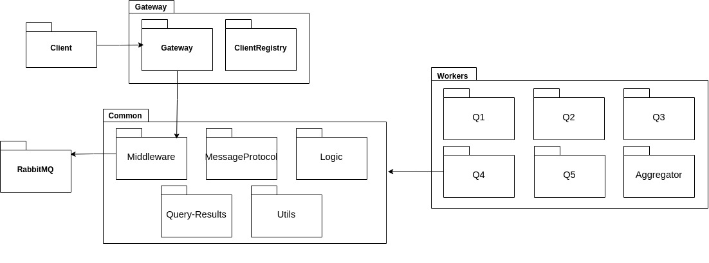
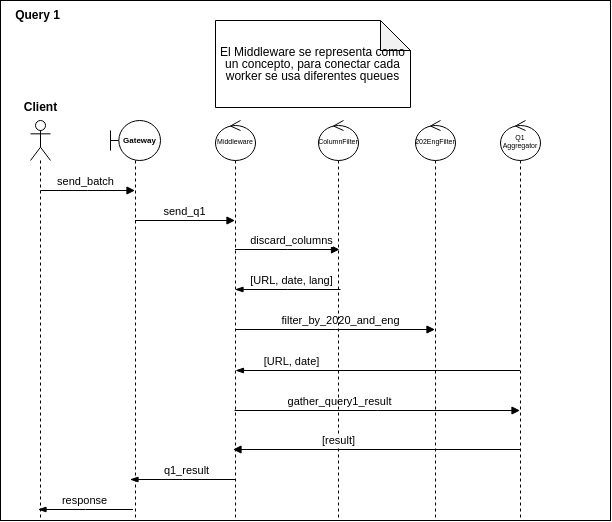
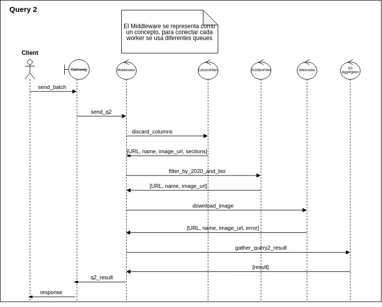
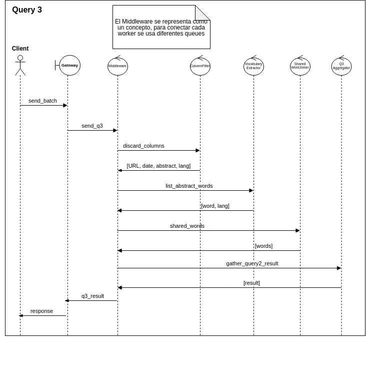
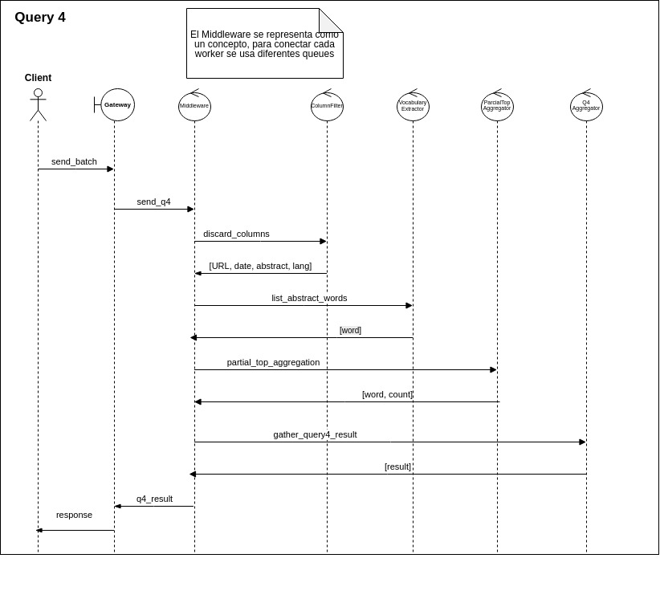
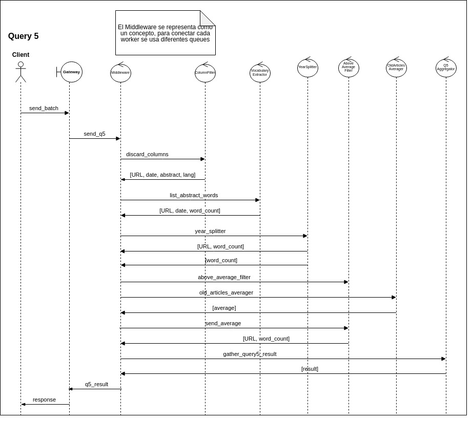

# TP Escalabilidad - Diagramas Actualizados

## DAG

#### Modificaciones / Nuevas decisiones de diseño
* En el TP de Diseño, los filtros finales enviaban los resultados directamente al Gateway. Al momento de la implementación, el diseño se modificó para que los resultados de cada query se envíen a un nodo `ResultAggregator` destinado específicamente a ese tipo de query. De esta manera, los workers que actúan en la etapa final de procesamiento no envían el resultado parcial directamente al Gateway, sino a su propio Aggregator. Estos nodos se encargan de bufferear fragmentos de las respuestas a las distintas querys, es decir los resultads parciales, hasta que éstas estén completas y, al recibir la barrera de EOF, se envía un único paquete consolidado al Gateway.

* Previamente se tenía un nodo que extraía el vocabulario “raw” desde el abstract de un artículo, y otro nodo que filtraba las stop words. Como decisión de diseño, se juntaron ambos nodos en uno sólo: `VocabularyExtractor`, ya que consideramos que, como de todos modos se deben recorrer todas las palabras del texto, es más rentable ir filtrando las palabras a medida que se recorre el mismo en memoria, que agregar otra fase de mensajería por red.

## Diagrama de Robustez

#### Modificaciones / Nuevas decisiones de diseño
* **Protocolo Cliente-Servidor**: Se emplea un protocolo binario propio. El cliente lee las filas del parquet, las serializa a mapas _[clave,valor]_ que va guardando en batches (tamaño configurable), para enviarlas al gateway sin procesamiento adicional. Para devolver los resultados de las querys, todos los nodos aggregators de resultados publican a la misma queue de la cual lee el gateway, y éste sólo se encarga de forwardear las respuestas completas al cliente.
* **Query 5**: Previamente, para resolver la query 5, la lógica de calcular el promedio y guardar las cantidades de palabras de los demás artículos estaba en un sólo nodo. Tras considerar que esto posiblemente se convierta en un cuello de botella, con mucho consumo de memoria, se separaron las responsabilidades:
   * Un nodo `YearSplitter` es un nodo stateless que se fija si el año es <= ó > a 2020, y en base a ésto envía la data al nodo `OldArticlesAverager` ó `AboveAverageFilter` respectivamente. El envío se realiza a través de un exchange, haciendo uso de hashing por client ID.
   * `OldArticlesAverager` recibe la cantidad de palabras de los artículos <= 2020 para un mismo cliente. Cuando recibe el EOF, le envía el promedio al nodo `AboveAverageFilter` correspondiente al cliente.
   * `AboveAverageFilter` recibe la cantidad de palabras de los artículos >2020 para un mismo cliente. Para avanzar a la siguiente etapa, es necesario que haya recibido tanto el mensaje EOF como el promedio. Finalmente, el envío de los artículos resultados al correspondiente nodo aggregator se hace con streaming de a batches.
* **Sincronización multi-upstream y barrera de EOFs (Queries 1 a 5):** Al haber etapas replicadas en múltiples instancias, los workers aguas abajo (`year_filter`, `english_filter`, `bio_filter`, `image_downloader`, `shared_words_aggregator`, `partial_top_aggregator`, `year_splitter` y los `result_aggregator`) implementan una barrera de sincronización por cliente (`recvEofCountMap[clientID] >= UPSTREAM_AMOUNT`). Ningún worker emite resultados parciales ni EOF aguas abajo hasta que todas las réplicas upstream hayan finalizado.
* **Manejo de estado concurrente en Q3 y Q4:** En `SharedWordsAggregator` (acumulación de idiomas `en`/`fr` por palabra) y `PartialTopAggregator` (conteo de frecuencias de palabras), el estado se particiona en mapas aislados por `clientID` protegidos mediante `sync.Mutex`, garantizando la atención simultánea de múltiples clientes sin colisiones ni memory leaks (el estado de un cliente se libera inmediatamente al emitir su resultado).
* **Garantía de orden y no-adelantamiento de EOF:** El enrutamiento por hash determinístico envía los datos de un artículo/palabra y el EOF correspondiente a través de la misma cola directa hacia el mismo shard. Gracias al orden FIFO garantizado por RabbitMQ a nivel de cola, es imposible que un EOF adelante a los datos en tránsito.
* **Thread-Safety en el Middleware AMQP:** Dado que los canales de RabbitMQ (`amqp.Channel`) no son seguros para concurrencia y el Gateway maneja clientes en goroutines independientes, se implementó exclusión mutua (`sendMu sync.Mutex`) en las primitivas de publicación (`Publish`) para evitar la corrupción de frames binarios TCP durante la transmisión simultánea de múltiples clientes.

## Diagrama de Despliegue

#### Modificaciones / Nuevas decisiones de diseño y Escalabilidad
* Se agregaron los nodos: `QXResultAggregator`, `VocabularyExtractor`, `YearSplitter`, `OldArticlesAverager`, `AboveAverageFilter`.
* Se quitaron los nodos: `WordCounter`, `StopwordsFilter`.
* **Cumplimiento del requisito de escalabilidad ($\ge 60\%$):** El pipeline cuenta con 16 tipos de workers, de los cuales **10 escalan horizontalmente (62.5%)**:
   * *Nodos compartidos escalados (3):* `ColumnFilter`, `YearFilter`, `VocabularyExtractor`.
   * *Nodos específicos por query escalados (7):* `EnglishFilter` (Q1), `BioFilter` (Q2), `ImageDownloader` (Q2), `SharedWordsAggregator` (Q3), `PartialTopAggregator` (Q4), `OldArticlesAverager` (Q5), `AboveAverageFilter` (Q5).
* **Mecanismos de distribución de carga (Sharding):**
   * *Por `article_id`:* Dispersión uniforme mediante `FNV-1a(article_id) % N` para ingesta y filtros de Q1 y Q2.
   * *Por palabra (`word`):* Dispersión mediante `FNV-1a(word) % N` en Q3 y Q4. Garantiza que todas las ocurrencias de una misma palabra caigan en el mismo shard, permitiendo conteos y detecciones de idiomas independientes en paralelo.
   * *Por `client_id`:* Dispersión en Q5 (`OldArticlesAverager` y `AboveAverageFilter`) para balancear la carga de clientes concurrentes.
* **Justificación de workers monoinstancia (6 tipos / 37.5%):**
   * Los sumideros finales (`q1_aggregator` a `q5_aggregator`) actúan como reducers finales de bajo cómputo (ordenamiento alfabético, consolidación de tops parciales o empaquetado del paquete único para el cliente). Replicarlos agregaría sobrecosto de coordinación sin beneficio de throughput.
   * `YearSplitter` realiza un ruteo condicional liviano por año sin retención de estado en memoria.
* **Infraestructura desplegada:** El clúster estándar se compone de **28 contenedores de servicio** (20 réplicas de workers escalados + 6 workers monoinstancia + 1 Gateway TCP↔AMQP + 1 broker RabbitMQ), además de los contenedores de clientes concurrentes.

## Diagrama de Paquetes

#### Modificaciones / Nuevas decisiones de diseño
##### Worker: Result Aggregator 
En lugar de crear un Aggregator distinto para cada query, se diseñó un Aggregator genérico y se delegó la lógica específica de serialización y construcción del resultado final a una interfaz que implementan los resultados de cada query.

Los Aggregators no mantienen los resultados en memoria RAM. Implementamos un paquete Storage que escribe los resultados parciales en archivos físicos (uno por cliente y por query). Al recibir el EOF del cliente, el Aggregator lee el archivo, consolida los datos, envía la respuesta final al Gateway y elimina el archivo, evitando desbordar la memoria del sistema.

##### Worker: Gateway 
Dado que cada query se procesa en paralelo y termina en tiempos distintos, el Gateway no puede cerrar el socket del cliente al recibir el primer resultado. Se implementó un contador en el ClientRegistry. El Gateway espera recibir los resultados (y los EOFs) de cada query antes de enviarle la señal de fin (EOF) al cliente y cerrar la conexión TCP de forma segura.

##### Worker: Image Downloader
Por otro lado, durante la conexión directa con la API de Wikipedia, fue necesario el uso de certificados de seguridad que permitieran realizar consultas a la API. Se resolvió agregando la instalación del paquete ca-certificates en el Dockerfile del worker. Además, Wikipedia bloquea peticiones automatizadas sin un encabezado User-Agent. Para manejar este error, se modificó la función de petición HTTP en Go para inyectar un User-Agent personalizado.

La obtención de las imágenes para la Query 2 es una de las tareas más críticas del sistema, ya que depende de servicios externos y de red. Para garantizar la robustez y evitar bloqueos, el archivo download_image.go implementa una estrategia de descarga en múltiples capas:

Para cada artículo, el sistema primero intenta descargar la imagen utilizando la URL directa (ImageURL) provista en el dataset original. Si esta falla, como segunda opción, construye una petición a la API REST de Wikipedia (/page/summary/) para obtener la miniatura oficial del artículo. Para esto último, detecta el idioma del artículo (inglés o francés) a partir de su URL.

Manejo de Reintentos y Rate Limiting: Las APIs de Wikipedia tienen límites de peticiones. El sistema implementa un mecanismo de reintentos con Exponential Backoff (esperas que aumentan exponencialmente: 1s, 2s, 4s...). 

Para evitar descargar la misma imagen dos veces o consultar repetidamente artículos que no tienen foto, se utiliza un directorio de caché (ImageCacheDir). Si el archivo .img ya existe, se lee desde el disco. Si existe un archivo .noimage, se asume que el artículo no tiene imagen y no se vuelve a consultar a la API.

Si después de todos los reintentos y el fallback la imagen no se puede obtener, el sistema no falla, sino que marca el error específico en el campo Error del objeto ImageArticle, para que el cliente final sepa qué artículos no pudieron obtener su imagen.

## Diagramas de Secuencia
#### Modificaciones / Nuevas decisiones de diseño

